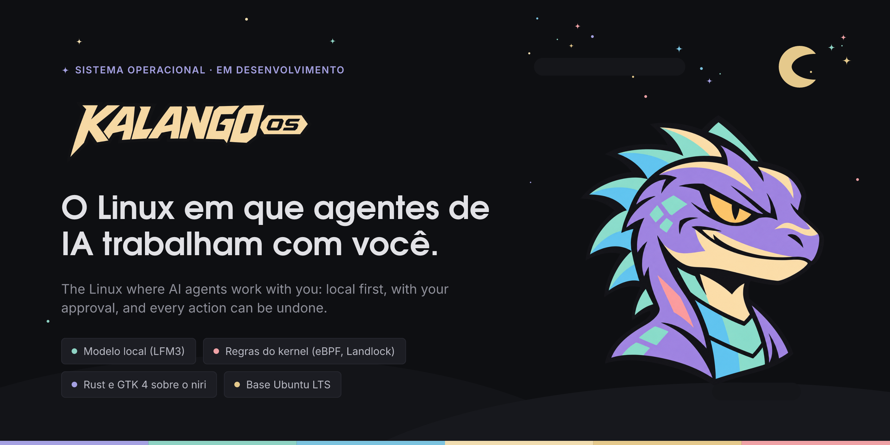

  

**Uma distribuição Linux em que agentes de IA trabalham com você — no seu computador, com a sua aprovação, e com
tudo podendo ser desfeito.**

> [!NOTE]
> **Em desenvolvimento.** Ainda não há imagem para instalar: o desktop, os apps e os agentes rodam numa sessão de
> desenvolvimento e numa máquina virtual. Acompanhe pelo [roteiro](https://github.com/kalangoos/kalangoos/blob/main/ROADMAP.md).

- **Agentes que fazem, não só conversam.** Organizam arquivos, leem a web, rodam tarefas — e pedem aprovação antes
  do que muda o seu computador.
- **Local por padrão.** O modelo padrão (LFM3) roda na sua máquina pelo llama.cpp; nuvem só se você quiser.
- **Tudo pode ser desfeito.** Cada ação entra na Linha do tempo, com ponto de restauração antes das que mudam algo.
- **Regras impostas pelo kernel.** Os agentes falam com o sistema pelo `kalangod` (MCP), com eBPF e Landlock.
- **Um desktop próprio.** Shell em Rust e GTK 4 sobre o niri, apps do próprio sistema, um único Design System.

### Repositórios

| Repositório | O que tem |
|---|---|
| [kalangoos](https://github.com/kalangoos/kalangoos) | O sistema: shell, `kalangod`, agentes, instalador, sessão, especificação |
| [design](https://github.com/kalangoos/design) | Tokens do Design System, a marca e os ícones dos apps |
| [niri](https://github.com/kalangoos/niri) | O compositor niri com os patches do KalangoOS (ramo `kalangoos`) |
| [kalangoos.github.io](https://github.com/kalangoos/kalangoos.github.io) | O site [kalangoos.com](https://kalangoos.com) |
| [.github](https://github.com/kalangoos/.github) | Este perfil, guias da comunidade e modelos compartilhados |

### Participe

[Como contribuir](https://github.com/kalangoos/.github/blob/main/CONTRIBUTING.md) ·
[Código de conduta](https://github.com/kalangoos/.github/blob/main/CODE_OF_CONDUCT.md) ·
[Segurança](https://github.com/kalangoos/.github/blob/main/SECURITY.md) ·
[kalangoos.com](https://kalangoos.com)

---

**English.** KalangoOS is a Linux distribution where AI agents work alongside you: local first, with your approval,
and with every action undoable. It is in development and there is no installable image yet. The code, the roadmap
and the releases live in [kalangoos/kalangoos](https://github.com/kalangoos/kalangoos).
